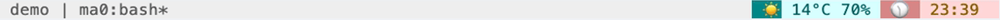

<div align="center">


# tmux-weather-nokey

[English](README.md)

현재 날씨와 시계 아이콘을 tmux 상태줄에 표시하는 플러그인입니다. API 키는 필요 없습니다.

tmux 3.x · POSIX sh · no API key

[](https://github.com/tmux/tmux)
[](https://github.com/elfenomenokim/tmux-weather-nokey/blob/main/LICENSE)

[설치](#설치) · [빠르게 써 보기](#빠르게-써-보기) · [전체 녹화](#전체-녹화)

</div>

<picture>
  <source media="(prefers-color-scheme: dark)" srcset="https://raw.githubusercontent.com/elfenomenokim/tmux-weather-nokey/main/docs/demo/weather-status-dark.png">
  <source media="(prefers-color-scheme: light)" srcset="https://raw.githubusercontent.com/elfenomenokim/tmux-weather-nokey/main/docs/demo/weather-status-light.png">
  
</picture>

## 설치

[TPM](https://github.com/tmux-plugins/tpm)을 쓴다면 `~/.tmux.conf`에 아래 설정을 넣으세요. TPM의 `run` 줄보다 위에 둡니다.

```tmux
set -g @plugin 'elfenomenokim/tmux-weather-nokey'
set -g @weather-location 'Seoul'
set -g status-right '#{weather_pill}'
```

`prefix`와 `I`를 눌러 설치합니다. TPM 없이 쓰려면 저장소를 받고 `run-shell /경로/tmux-weather-nokey/weather.tmux`를 추가하세요.

## 빠르게 써 보기

아래 예시는 샘플 캐시를 읽습니다. 실제 날씨 서비스에는 접속하지 않습니다.

```console
$ WEATHER_CACHE_DIR=/tmp/weather-nokey-cache scripts/weather.sh full
☀️ 14°C 70%
$ WEATHER_CACHE_DIR=/tmp/weather-nokey-cache scripts/weather.sh icon
☀️
$ WEATHER_CACHE_DIR=/tmp/weather-nokey-cache scripts/weather.sh temp
14°C 70%
```

위 설정처럼 플러그인과 `#{weather_pill}`을 `~/.tmux.conf`에 넣으면 tmux에서 이 칸을 볼 수 있습니다.

## 전체 녹화

격리된 tmux 세션과 샘플 날씨 캐시에서 상태줄을 녹화했습니다.

<picture>
  <source media="(prefers-color-scheme: dark)" srcset="https://raw.githubusercontent.com/elfenomenokim/tmux-weather-nokey/main/docs/demo/weather-dark.gif">
  <source media="(prefers-color-scheme: light)" srcset="https://raw.githubusercontent.com/elfenomenokim/tmux-weather-nokey/main/docs/demo/weather-light.gif">
  
</picture>

## 상태 표시

색이 들어간 한 칸을 쓰려면 `#{weather_pill}`을 넣습니다. `#{weather}`, `#{weather_icon}`, `#{weather_temp}`, `#{clock_icon}`을 따로 배치할 수도 있습니다. `#{weather}`는 예를 들어 `☀️ 14°C 70%`로 표시됩니다.

`@weather-units`는 `metric` 또는 `imperial`입니다. `@weather-location`에는 도시 이름이나 `위도,경도`를 넣습니다. 위치가 비어 있으면 wttr.in은 IP로 위치를 추정할 수 있지만, Open-Meteo 예비 경로에는 도시나 좌표가 필요합니다.

## 날씨 조회와 캐시

먼저 wttr.in에 요청하고 응답이 비었거나 잘못되면 Open-Meteo를 씁니다. 형식이 맞는 날씨 값만 캐시에 저장합니다. 캐시가 유효하면 네트워크를 호출하지 않습니다. 두 서비스가 모두 안 되면 마지막 정상 값을 계속 보여 줍니다. 기본 캐시 시간은 1800초입니다.

<picture>
  <source media="(prefers-color-scheme: dark)" srcset="https://raw.githubusercontent.com/elfenomenokim/tmux-weather-nokey/main/docs/diagrams/cache-flow.dark.ko.svg">
  <source media="(prefers-color-scheme: light)" srcset="https://raw.githubusercontent.com/elfenomenokim/tmux-weather-nokey/main/docs/diagrams/cache-flow.light.ko.svg">
  
</picture>

스크립트는 POSIX `sh`와 `curl`을 씁니다. Open-Meteo 예비 경로에는 `jq`가 필요합니다. 계정이나 API 키는 필요 없습니다.

## 옵션

| tmux 옵션 | 기본값 | 기능 |
|---|---|---|
| `@weather-location` | 비어 있음 | 도시 또는 `위도,경도` |
| `@weather-units` | `metric` | `metric` 또는 `imperial` |
| `@weather-interval` | `1800` | 캐시 시간(초) |
| `@weather-timeout` | `3` | 요청 시간 제한(초) |
| `@weather-humidity` | `on` | `off`면 습도를 숨김 |
| `@weather-lang` | `en` | wttr.in 언어 코드 |

환경 변수나 `~/.config/tmux-weather-nokey/config`의 `key=value`로도 지정할 수 있습니다. 우선순위는 환경 변수, tmux 옵션, 설정 파일, 기본값 순입니다.

## 제한

`curl`이 필요합니다. 예비 경로에는 `jq`와 조회 가능한 위치가 필요합니다. 두 서비스가 모두 막히면 표시되는 값이 오래됐을 수 있습니다. 무료 서비스의 부하를 줄이려면 간격을 600초보다 짧게 설정하지 마세요.

## 기여

이슈와 풀 리퀘스트를 환영합니다. 셸 확인과 리뷰 방식은 [CONTRIBUTING.md](CONTRIBUTING.md)에 있습니다.

## 라이선스

MIT입니다. [LICENSE](LICENSE)를 보세요.
