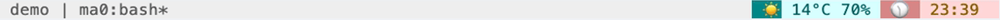

# tmux-weather-nokey

[한국어](README.ko.md)

A tmux plugin that shows current weather and a clock face in your status line without an API key.

tmux 3.x · POSIX sh · no API key

[](https://github.com/tmux/tmux)
[](https://github.com/elfenomenokim/tmux-weather-nokey/blob/main/LICENSE)

<picture>
  <source media="(prefers-color-scheme: dark)" srcset="https://raw.githubusercontent.com/elfenomenokim/tmux-weather-nokey/main/docs/demo/weather-status-dark.png">
  <source media="(prefers-color-scheme: light)" srcset="https://raw.githubusercontent.com/elfenomenokim/tmux-weather-nokey/main/docs/demo/weather-status-light.png">
  
</picture>

## Install

With [TPM](https://github.com/tmux-plugins/tpm), add these lines to `~/.tmux.conf` above TPM’s `run` line:

```tmux
set -g @plugin 'elfenomenokim/tmux-weather-nokey'
set -g @weather-location 'Seoul'
set -g status-right '#{weather_pill}'
```

Press `prefix` + `I` to install the plugin. Without TPM, clone this repository and add `run-shell /path/to/tmux-weather-nokey/weather.tmux`.

## Quick start

The sample below reads a seeded cache, so it uses no live weather service.

```console
$ WEATHER_CACHE_DIR=/tmp/weather-nokey-cache scripts/weather.sh full
☀️ 14°C 70%
$ WEATHER_CACHE_DIR=/tmp/weather-nokey-cache scripts/weather.sh icon
☀️
$ WEATHER_CACHE_DIR=/tmp/weather-nokey-cache scripts/weather.sh temp
14°C 70%
```

Add the plugin and `#{weather_pill}` to `~/.tmux.conf` as shown above to display the segment in tmux.

## Full recording

The recording shows the status line inside an isolated tmux session with a seeded weather cache.

<picture>
  <source media="(prefers-color-scheme: dark)" srcset="https://raw.githubusercontent.com/elfenomenokim/tmux-weather-nokey/main/docs/demo/weather-dark.gif">
  <source media="(prefers-color-scheme: light)" srcset="https://raw.githubusercontent.com/elfenomenokim/tmux-weather-nokey/main/docs/demo/weather-light.gif">
  
</picture>

## Status formats

Use `#{weather_pill}` for the coloured segment, or place `#{weather}`, `#{weather_icon}`, `#{weather_temp}` and `#{clock_icon}` separately in `status-right`. For example, `#{weather}` prints `☀️ 14°C 70%`.

Set `@weather-units` to `metric` or `imperial`. `@weather-location` accepts a city or `lat,lon`; wttr.in can infer a location when it is empty, but the Open-Meteo fallback needs coordinates or a city name.

## How it gets weather

The plugin requests wttr.in first and uses Open-Meteo if that response is empty or invalid. It caches only a recognized weather line. A cache hit runs no network request; if both sources fail, the last good cached value remains visible. The default cache interval is 1800 seconds.

<picture>
  <source media="(prefers-color-scheme: dark)" srcset="https://raw.githubusercontent.com/elfenomenokim/tmux-weather-nokey/main/docs/diagrams/cache-flow.dark.svg">
  <source media="(prefers-color-scheme: light)" srcset="https://raw.githubusercontent.com/elfenomenokim/tmux-weather-nokey/main/docs/diagrams/cache-flow.light.svg">
  
</picture>

The scripts use POSIX `sh` and `curl`. `jq` is optional and enables the Open-Meteo fallback. No account or API key is required.

## Options

| tmux option | Default | Purpose |
|---|---|---|
| `@weather-location` | empty | City or `lat,lon` |
| `@weather-units` | `metric` | `metric` or `imperial` |
| `@weather-interval` | `1800` | Cache time in seconds |
| `@weather-timeout` | `3` | Request timeout in seconds |
| `@weather-humidity` | `on` | Set `off` to hide humidity |
| `@weather-lang` | `en` | wttr.in language code |

Each option can also come from an environment variable or `~/.config/tmux-weather-nokey/config` (`key=value`, one per line). Environment variables take priority, then tmux options, config file and defaults.

## Limits

`curl` is required. The fallback requires `jq` and a location it can resolve. Weather values depend on the upstream services and can be stale while both are unavailable. Keep the interval at 600 seconds or longer to avoid overloading the free services.

## Contributing

Issues and pull requests are welcome. See [CONTRIBUTING.md](CONTRIBUTING.md) for the shell checks and the review process.

## License

MIT. See [LICENSE](LICENSE).
